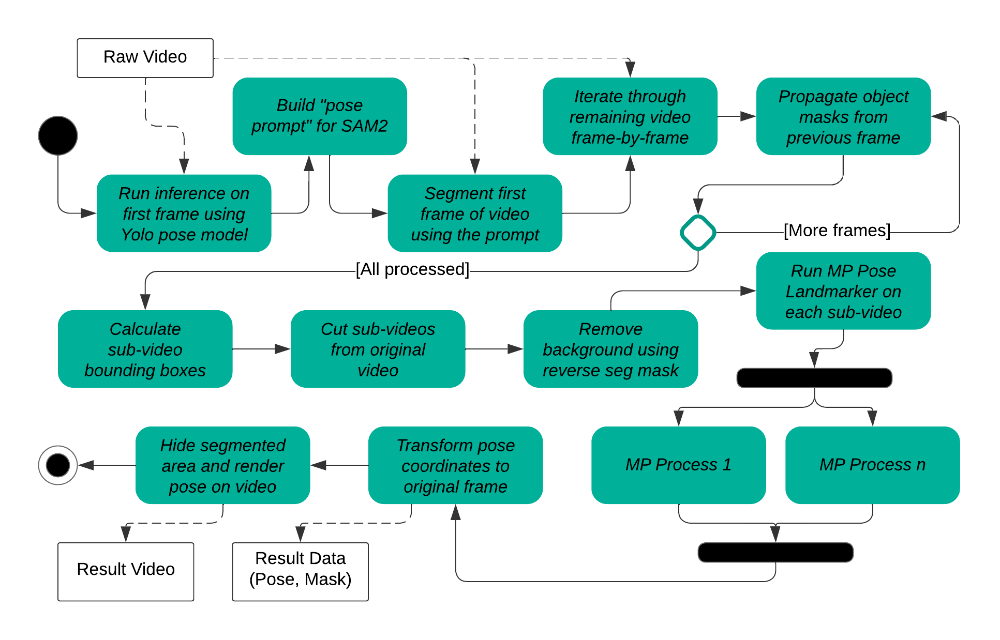
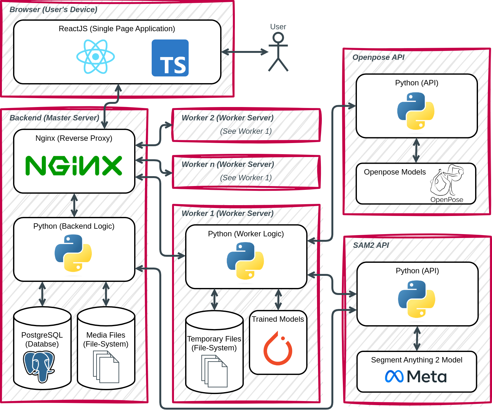

<h1 align="center">MaskAnyone - The de-identification toolbox for video data.</h1>

## Overview
MaskAnyone is a **de-identification toolbox for videos** that allows you to remove personal identifiable information from videos, while at the same time preserving utility. It provides a variety of algorithms that allows you to **anonymize videos** (video & audio) with just a few clicks. Anonymization algorithms can be selected and combined depending on what aspects of utility should be preserved and which computational resources are available.

MaskAnyone is a docker-packaged modern web app that is built with React, MaterialUI, FastAPI and PostgreSQL. It is designed to be easily extensible with new algorithms and to be scalable with multiple docker workers. It is also designed to be easily usable by non-technical users.

## Sample outputs

https://github.com/user-attachments/assets/92dac144-9f15-4665-8d19-5e978d4bf4ba

Good examples that showcase what can be achieved with this approach are available here: https://drive.google.com/drive/folders/1QwlFgf-PTI46yqe8wKyC9C-YMwfF2z6o?usp=sharing. 

We have evaluated this approach against other approaches on various videos which can be found here, both as originals and masked versions: https://drive.google.com/drive/folders/1DGelFxPJhnXD_2FKoIDC76uJNvXT3ccC?usp=sharing.

## Getting Started

MaskAnyone runs as a set of Docker containers. The `setup.sh` script checks your system, builds the images, starts all services and reports whether everything came up.

### Requirements

- [Docker](https://docs.docker.com/get-docker/) with Docker Compose v2 (included in Docker Desktop)
- At least **30 GB** of free disk space and **16 GB** of RAM (8 GB works with smaller chunk sizes)
- A **bash** terminal (see your operating system below)
- Free ports: `443` (the app) and `5433` (pgAdmin); `8080` as well if you use login mode
- Recommended: an **NVIDIA GPU**. Without one, only **Basic masking** (MediaPipe) is available; **Advanced masking** with SAM2 needs the GPU (see [How to use](#how-to-use)).

> **Note:** OpenPose works on NVIDIA RTX 20-, 30- and 40-series GPUs, but not on RTX 50-series (Blackwell) GPUs. On these GPUs, choose MediaPipe for pose overlays; SAM2 masking works normally. See [TROUBLESHOOTING.md](./TROUBLESHOOTING.md).

### Prepare your system

<details>
<summary><b>Linux</b></summary>

- Install [Docker Engine](https://docs.docker.com/engine/install/) and the Compose plugin.
- Allow your user to run Docker without `sudo`: `sudo usermod -aG docker $USER`, then log out and back in.
- For GPU support, install the [NVIDIA driver](https://www.nvidia.com/drivers) and the [NVIDIA Container Toolkit](https://docs.nvidia.com/datacenter/cloud-native/container-toolkit/install-guide.html).
- Any terminal works.

</details>

<details>
<summary><b>Windows</b></summary>

- Install [Docker Desktop](https://docs.docker.com/desktop/setup/install/windows-install/) with the WSL 2 backend (the default).
- Install [Git for Windows](https://git-scm.com/download/win), which includes **Git Bash**.
- Run all commands below in **Git Bash**, not in PowerShell or Command Prompt: `setup.sh` is a bash script.
- For GPU support, an up-to-date [NVIDIA driver](https://www.nvidia.com/drivers) is enough; Docker Desktop passes the GPU through to the containers.

</details>

<details>
<summary><b>macOS</b></summary>

- Install [Docker Desktop](https://docs.docker.com/desktop/setup/install/mac-install/) and give it at least 8 GB of memory (Settings → Resources).
- The built-in Terminal works.

> **Note:** On macOS, MaskAnyone currently runs in CPU mode only, so only **Basic masking** (MediaPipe) is available. Advanced masking uses SAM2, which needs an NVIDIA GPU (CUDA); Macs do not have one.

</details>

### Install

Choose one of the two ways. Both end with the same running app: `setup.sh` runs the steps for you and checks your system along the way, while the manual install lists the commands so you can run them yourself.

MaskAnyone runs in one of two modes:

- **Local mode** (default): no login, a single user. For running MaskAnyone on your own computer.
- **Server mode**: login with user accounts (via Keycloak), so several people can use one installation, for example on a shared server.

Both install options below cover both modes.

<details>
<summary><b>Docker Compose files and base commands</b></summary>

The repository has four Docker Compose files:

| File | Purpose |
|---|---|
| `docker-compose.yml` | The main app. Used in every setup. Runs without a GPU (Basic masking). |
| `docker-compose-gpu.yml` | Add-on for machines with an NVIDIA GPU. Adds GPU access and the SAM2 and OpenPose services (Advanced masking). Used together with `docker-compose.yml`. |
| `docker-compose-cli.yml` | Command-line version, without the web app. See [For developers](#for-developers). |
| `docker-compose-build.yml` | Used by the maintainers to build and publish images. Not needed for installing. |

Without a GPU, SAM2 and OpenPose are not built or started at all, which saves a long build and several GB of disk space.

**Base command.** The `docker compose …` commands in this README are written for the simplest setup. Replace `docker compose` with the base command for your setup:

| Your setup | Base command |
|---|---|
| NVIDIA GPU, local mode | `docker compose -f docker-compose.yml -f docker-compose-gpu.yml` |
| NVIDIA GPU, server mode | `docker compose -f docker-compose.yml -f docker-compose-gpu.yml --profile auth` |
| No NVIDIA GPU, local mode | `docker compose` |
| No NVIDIA GPU, server mode | `docker compose --profile auth` |

For example, with a GPU in local mode, `docker compose up -d` becomes `docker compose -f docker-compose.yml -f docker-compose-gpu.yml up -d`.

With the automated install you do not need these: `setup.sh` picks the right files by itself, also for starting (`bash setup.sh --skip-build`) and stopping (`bash setup.sh stop`).

</details>

<details>
<summary><b>Automated install with setup.sh (recommended)</b></summary>

```bash
git clone -b samhack https://github.com/MaskAnyone/MaskAnyone.git
cd MaskAnyone
bash setup.sh
```

The first run takes 20–60 minutes with a GPU, depending on your internet connection. Without a GPU it is faster, because the two largest images (SAM2 and OpenPose) are skipped. With a GPU, the script asks which SAM2 model sizes to include; then it builds and starts everything. When it finishes, open [https://localhost](https://localhost). Your browser will warn about a self-signed certificate: choose "Advanced" and continue.

On a fresh install, two sample videos are added to your library so you can try MaskAnyone straight away. A log of each run is saved in `logs/`.

`setup.sh` detects whether you have an NVIDIA GPU and uses the right configuration; without one it skips SAM2 and OpenPose. It installs **local mode** unless you add `--with-auth`. Options:

| Option | What it does |
|---|---|
| `--with-auth` | **Server mode**: login with user accounts via Keycloak |
| `--sam2-models=small,large` | Choose the SAM2 model sizes without being asked (`tiny`, `small`, `base_plus`, `large`). GPU only; ignored without a GPU |
| `--skip-build` | Use the existing images, skip the build |
| `stop` | Stop MaskAnyone; keeps images, videos and results |
| `doctor` | Check a running install and suggest fixes; changes nothing |
| `--clean` | Stop the containers and remove the images; keeps your videos and results |
| `--clean-all` | Remove everything, **including all videos, results and the database** (asks for confirmation) |

**Starting and stopping later:**

```bash
bash setup.sh --skip-build   # start, with the same checks as the install
bash setup.sh stop           # stop
```

In server mode, add `--with-auth` to the start command, otherwise it switches back to local mode.

</details>

<details>
<summary><b>Manual install (without setup.sh)</b></summary>

For users who want to run the steps themselves. In every command below, replace `docker compose` with the base command for your setup (see [Docker Compose files and base commands](#install) above).

> **Server mode:** before building, also set `MASK_ANYONE_PLATFORM_MODE=server` in `app.env` (the default is `local`).

```bash
git clone -b samhack https://github.com/MaskAnyone/MaskAnyone.git
cd MaskAnyone
docker compose build
docker compose run --rm yarn yarn install
docker compose up -d postgres
```

> **GPU only:** the SAM2 image includes only the `small` model by default. To include more, add `--build-arg SAM2_MODELS=tiny,small,base_plus,large` (or any subset) to the build command.

Wait a few seconds for the database, then start everything:

```bash
docker compose up -d
```

Open [https://localhost](https://localhost). Your browser will warn about a self-signed certificate: choose "Advanced" and continue.

If a build times out because of your connection, run the command again; finished steps are cached.

**Starting and stopping later:**

```bash
docker compose up -d   # start (with your base command)
docker compose down    # stop (with your base command, so server mode includes --profile auth)
```

</details>

<details>
<summary><b>Upgrading an existing install</b></summary>

Your videos, results and database live in `./data` and are kept. Docker rebuilds only what changed.

> **Note for GPU installs:** the Docker Compose files were reorganised. `docker-compose.yml` now runs without a GPU, and the GPU setup needs `-f docker-compose.yml -f docker-compose-gpu.yml` (see [Docker Compose files and base commands](#install)). A plain `docker compose up -d` now starts MaskAnyone without SAM2 and OpenPose. `setup.sh` handles this by itself.

Automated install:

```bash
git pull
bash setup.sh
docker compose exec postgres psql -U dev -d prototype -c "ALTER TABLE jobs ADD COLUMN IF NOT EXISTS phase varchar;"
```

Manual install (use your base command from the manual install section in place of `docker compose`):

```bash
git pull
docker compose build
docker compose up -d
docker compose exec postgres psql -U dev -d prototype -c "ALTER TABLE jobs ADD COLUMN IF NOT EXISTS phase varchar;"
```

The `psql` command adds a database column that this version needs. The database schema is only created on the very first install, so existing databases have to be updated by hand. The command is safe to run more than once.

</details>

**If something goes wrong:** run `bash setup.sh doctor`, which checks a running install and prints a fix for each problem it finds. Common issues (502 Bad Gateway, port 443 in use, GPU errors) are covered in [TROUBLESHOOTING.md](./TROUBLESHOOTING.md). For anything else, please [open an issue on GitHub](https://github.com/MaskAnyone/MaskAnyone/issues).

## How to use

### 1. Upload a video

Click **Upload** in the sidebar and drop in your files (MP4, up to 500 MB each).

<details>
<summary><b>Changing the upload limit</b></summary>

To change the limit, set `MAX_VIDEO_UPLOAD_BYTES` (in bytes) in `app.env`, for example `MAX_VIDEO_UPLOAD_BYTES=1000000000` for 1 GB, and restart:

```bash
bash setup.sh --skip-build
```

A plain `docker compose restart` does not pick up the new value; the backend container must be recreated, which `setup.sh` does. Limits above 2 GB also need `client_max_body_size` raised in `docker/nginx/conf/www.conf`.

</details>

### 2. Mask the video

There are two ways to mask a video. **Basic masking** runs on any machine. **Advanced masking** needs an NVIDIA GPU and gives you control over who is masked and how.

<details>
<summary><b>Basic masking (CPU, MediaPipe)</b></summary>

People are found automatically with MediaPipe; there is nothing to mark by hand.

1. Select the video and click **Basic Masking**. To mask several videos with the same settings, tick them in the sidebar and click the shield icon (**Mask selected**) at the top of the sidebar instead.
2. **Video Masking:** choose blurring, pixelation, contours or solid fill. Set the strength (1–5), or for solid fill the colour (the average colour of the person, or one you pick). Optionally add a skeleton overlay.
3. **Voice Masking:** keep the audio, remove it, or switch the voice so the speaker cannot be recognised.
4. Click **Mask Video**.

**How voice switching works.** **Switch** changes the voice with the McAdams coefficient method (Patino et al., "Speaker anonymisation using the McAdams coefficient", Interspeech 2021), a baseline of the VoicePrivacy Challenge. It analyses the audio in short frames (20 ms) and shifts the resonances of the vocal tract (the formants), which changes how the voice sounds without changing what is said. Words, timing, intonation and non-speech sounds (laughter, breathing) stay intact, while automatic speaker recognition is made much harder. It runs on the CPU in about real time and needs no AI model. If the video has no audio track or the conversion fails, the audio is removed instead, so the original voice is never kept by mistake.

</details>

<details>
<summary><b>Advanced masking (NVIDIA GPU, SAM2)</b></summary>

You mark each person once; SAM2 then follows them through the video.

1. Select the video and click **Advanced Masking**. MaskAnyone detects the people in the current frame and places prompt points on them, one target per person.
2. **Adjust the prompts.** Drag points to move them, click a point to switch it between subject (+) and background (−), right-click the image to add a point and right-click a point to remove it. Use **Detect Poses** or **Detect Objects** to re-detect, **Add New Target** for someone that was missed, and **Prompt Another Frame** if a person only appears later in the video.
3. **Choose how each person is masked.** For every target, pick a hiding method (blurring, pixelation, solid fill, transparent fill, contours or none) and an optional pose overlay (MediaPipe or OpenPose). Detected people start with solid fill and MediaPipe Pose. Then pick the SAM2 model size and, for long videos, the chunk size (a recommendation is preselected).
4. **Check and run.** **Test Prompt** previews the segmentation for the current frame. **Mask** starts the job.

The audio is removed from advanced masking results.

Overview of the advanced masking process:



</details>

### 3. Follow progress

Open the **Runs** page to see the progress of each job. You can also cancel a job there.

### 4. Review and download

The finished result appears under the video, next to the original. From there you can download the masked video, the extracted data (for example pose keypoints and, for advanced masking, the mask QA report), or a zip of one result or of all results of the video. For advanced masking results, **Refine Result** re-opens the editor so you can correct the prompts and run again.

<details>
<summary><b>Reading the file names</b></summary>

Downloaded files are named `<video>_<settings>`, for example `interview01_p1-blur-mp-p2-fill-op25-sam2s.mp4`: person 1 blurred with a MediaPipe Pose overlay, person 2 with solid fill and an OpenPose BODY_25 overlay, segmented with SAM2 small. The full, readable settings are in `README.txt` and `masking_config.json` inside each result zip.

| Code | Meaning |
|---|---|
| `p1`, `p2`, … | Person 1, person 2, … (only when people have different settings) |
| `mixed-5p` | 5 people with different settings (used from 4 people on) |
| `blur`, `pixel`, `fill`, `tfill`, `contour`, `nohide` | Hiding: blurring, pixelation, solid fill, transparent fill, contours, no hiding |
| `mp`, `mpface`, `mphand` | Overlay: MediaPipe Pose, Face, Hands |
| `op25`, `op25b`, `op25face`, `op135` | Overlay: OpenPose BODY_25, BODY_25B, BODY_25 + Face, BODY_135 |
| `…-only` | Overlay without hiding, e.g. `op25-only` |
| `nomask` | No hiding and no overlay |
| `sam2t`, `sam2s`, `sam2b`, `sam2l` | SAM2 model: tiny, small, base+, large |
| `traces` | Motion traces turned on |
| `v2`, `v3`, … | Refined version of an earlier result |
| `basic-…` | Basic masking, e.g. `basic-blurring` |

A result you renamed in the app keeps your name, e.g. `interview01_my-final-version.mp4`.

</details>

## For developers

In this section we have collected some further information for developers. As in the install steps, replace `docker compose` with the base command for your setup (see [Docker Compose files and base commands](#install)), except for the CLI, which uses its own file.

<details>
<summary><b>Architecture</b></summary>



</details>

<details>
<summary><b>Services</b></summary>

- Frontend: [https://localhost](https://localhost) (Test user `test:test`, login mode only; the default local mode has no login)
- Backend: [https://localhost/api/docs](https://localhost/api/docs)
- Keycloak: [https://localhost/auth/](https://localhost/auth/) (Admin user: `dev:dev`)
- PGAdmin: [https://localhost:5433/](https://localhost:5433/) (Password: `dev`)

</details>

<details>
<summary><b>CLI</b></summary>

To run the CLI version first put the videos for masking into the folder `data/backend/videos`. Then execute the following commands:
```
docker compose -f docker-compose-cli.yml build
docker compose -f docker-compose-cli.yml run cli python3 cli.py --input-path /data/videos --output-path /data/results --hiding-strategy blurring --overlay-strategy mp_pose # example
```
Possible hiding strategies are: `solid_fill, transparent_fill, blurring, pixelation, contours, none`.

Possible overlay strategies are: `mp_hand, mp_face, mp_pose, openpose, openpose_body25b, openpose_face, openpose_body_135, none`.

The results will be stored in `/data/backend/results`. Note that you have to clear the results folder before masking again, otherwise it will not mask any video.

</details>

<details>
<summary><b>Debugging</b></summary>

Run the application with 
```bash
docker compose up
```
to get the live output of the application and see where it might crash.
Alternatively you can use `docker compose logs -f` if you already started the application using the detached (`-d`) flag.

For a quick health check of a running install, run:
```bash
bash setup.sh doctor
```

See [TROUBLESHOOTING.md](./TROUBLESHOOTING.md) for known issues (GPU compatibility, OpenPose on new hardware, Windows Python PATH quirks, etc.).

</details>

<details>
<summary><b>Database</b></summary>

**Export Schema**
If you changed the schema of the DB please run the following command to refresh the schema dump.
This is to ensure that the DB schema dump is up-to-date for whenever someone sets up the project.
```bash
docker compose exec postgres pg_dump --schema-only --no-owner --username dev --create prototype > ./docker/postgres/docker-entrypoint-initdb.d/prototype.sql
```
You can also exclude the `--schema-only` parameter to include both the schema and the data in the dump.

Similarly, if you changed anything regarding the Keycloak configuration that should be included in the initial setup, please run the following command to update the Keycloak dump.
```bash
docker compose exec postgres pg_dump --username dev --create keycloak > ./docker/postgres/docker-entrypoint-initdb.d/keycloak.sql
```

</details>

## Status of the project
Mask Anyone was developed as a prototype showcasing different possibilities in the field of person de-identification in videos. 
While it can already produce very convincing results for a considerable subset of videos, there are still a number of issues that need to be addressed.
Please exercise caution when using this application and do not blindly rely on the results without verifying their integrity yourself.

### Credits
We thank the authors of different implementations we packaged in our project. Our project relies heavily on the work of

- Google [MediaPipe](https://github.com/google/mediapipe) for segmentation and pose estimation
- UltraLytics [YOLOv11](https://github.com/ultralytics/ultralytics) for person detection
- [Openpose](https://github.com/CMU-Perceptual-Computing-Lab/openpose) for pose estimation
- Meta [SAM2](https://github.com/facebookresearch/sam2) for video segmentation

and many more.
